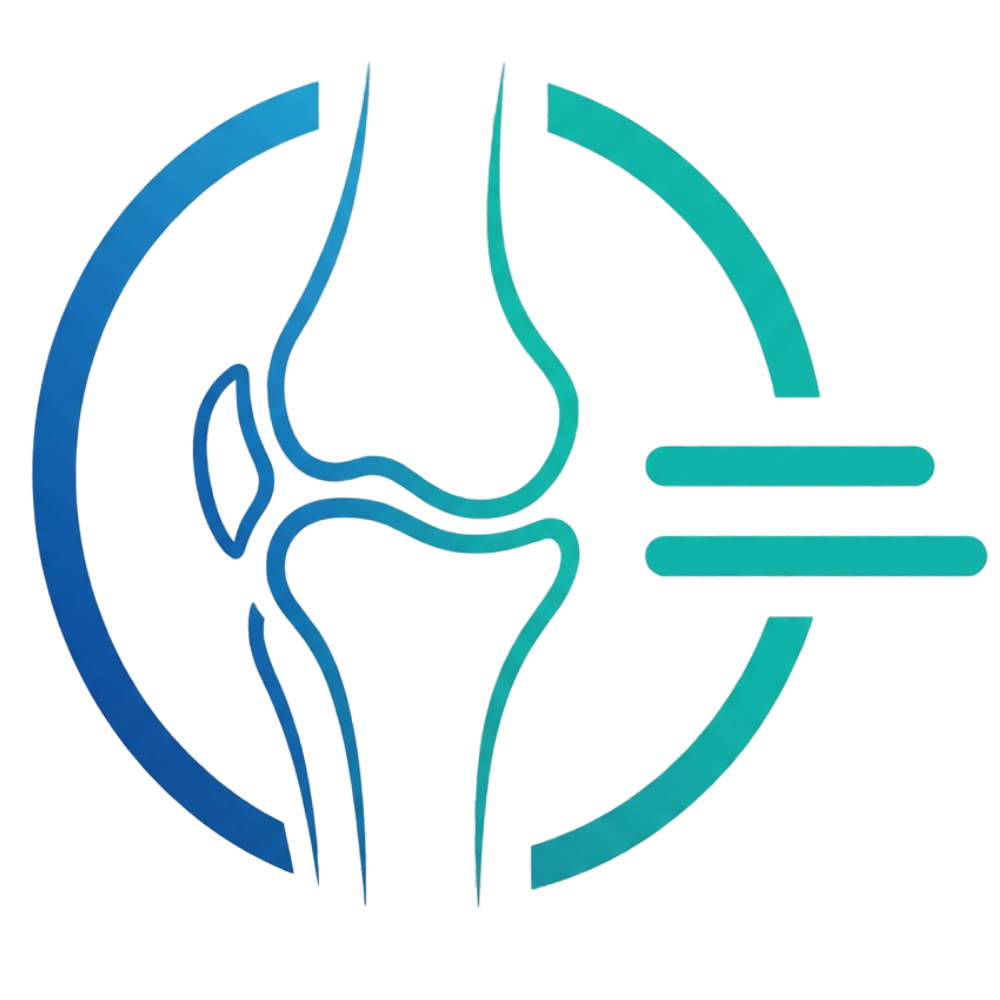
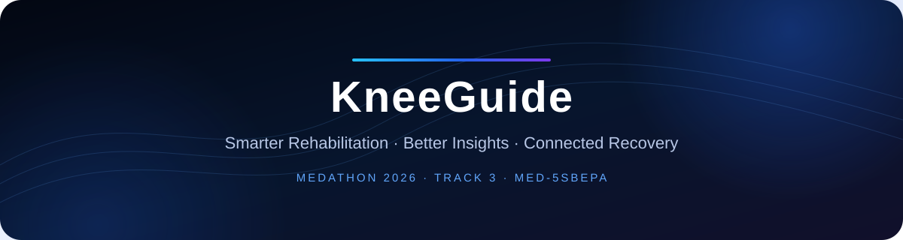
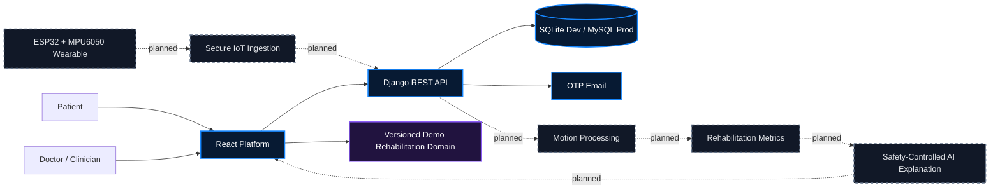

  
  <h1>KneeGuide Team</h1>
  
<strong>Smarter Rehabilitation. Better Insights. Connected Recovery.</strong>

  
AI-assisted smart knee rehabilitation for patients and healthcare professionals.

  

    
    
    
  

> **Medical-technology prototype:** KneeGuide supports rehabilitation monitoring and clinician decision-making. It does not diagnose, prescribe treatment, replace clinical assessment, or claim clinically validated outcomes.

## English overview

KneeGuide is a connected rehabilitation ecosystem designed to improve how knee-recovery information is recorded, communicated, and reviewed between patients and healthcare professionals. The project combines a bilingual web platform, structured rehabilitation workflows, a Django REST backend, and a planned wearable motion-sensing architecture.

Traditional rehabilitation is often evaluated through periodic appointments and patient-reported progress. KneeGuide explores how objective movement measurements, structured exercise records, appointment workflows, and clinician review can complement—not replace—professional assessment.

## نظرة عامة بالعربية

**KneeGuide** هو نموذج تقني لمنظومة تأهيل ذكية تهدف إلى تحسين متابعة تعافي الركبة والتواصل بين المريض والمختص الصحي. تجمع المنصة بين واجهة للمريض، ولوحة للطبيب، وتمارين وتقارير ومواعيد، مع بنية مستقبلية لربط مستشعر حركة قابل للارتداء.

المشروع لا يقدم تشخيصًا طبيًا مستقلًا ولا يصف علاجًا ولا يستبدل قرار الطبيب. جميع وظائف الذكاء الاصطناعي وإنترنت الأشياء موضحة بصدق وفق حالتها الحالية: منفذة، تجريبية، أو مخططة.

## Repositories

| Repository | Purpose | Current maturity |
|---|---|---|
| [kneeguide-frontend](https://github.com/KneeGuide-Team/kneeguide-frontend) | React public website, authentication, patient experience, clinician experience, bilingual UI, charts and demonstration workflows | Advanced product prototype; authentication uses the real API while dashboard rehabilitation data is currently a deliberate local demo domain |
| [kneeguide-backend](https://github.com/KneeGuide-Team/kneeguide-backend) | Django REST APIs, users, OTP verification, JWT authentication, exercises, reports, appointments, MySQL production persistence and Admin | Implemented backend foundation with remaining workflow integration, hardening and broader automated testing |

### Quick links

- [Live platform](https://knee.fyaa.io/)
- [Deployed backend](https://kneeguide-backend.onrender.com/)
- [Frontend technical documentation](https://github.com/KneeGuide-Team/kneeguide-frontend#readme)
- [Backend technical documentation](https://github.com/KneeGuide-Team/kneeguide-backend#readme)
- [Contribution guide](https://github.com/KneeGuide-Team/.github/blob/main/CONTRIBUTING.md)
- [Security policy](https://github.com/KneeGuide-Team/.github/blob/main/SECURITY.md)

## The rehabilitation challenge

Between clinical appointments, professionals may have limited visibility into exercise adherence, range-of-motion trends, pain reports, and changes in recovery behavior. Patients may also struggle to understand their next exercise, appointment, progress, or clinician feedback.

KneeGuide proposes a shared rehabilitation record that can bring together:

1. Patient and clinician accounts.
2. Assigned rehabilitation exercises.
3. Session and adherence records.
4. Progress reports and clinician feedback.
5. Appointment coordination.
6. A planned ESP32/MPU6050 wearable prototype.
7. Planned secure motion-data ingestion and analysis.
8. A future safety-controlled AI explanation layer.

## Platform ecosystem

| Visual treatment | Meaning |
|---|---|
| Blue | Implemented platform or API foundation |
| Violet | Intentional demonstration data/workflow |
| Dashed slate | Planned integration, not operational in the inspected repositories |

## Product environments

### Patient experience

- Bilingual registration, OTP verification and login.
- Rehabilitation dashboard and daily guidance.
- Exercise-session experience and local completion history.
- Progress, pain and report visualizations.
- Appointment request demonstration flow.
- Profile, medical-information and device-interface areas.
- Deterministic bilingual assistant actions.

### Clinician experience

- Patient worklist and attention indicators.
- Patient rehabilitation workspace.
- Exercise, session, report and appointment views.
- Clinician notes and report review.
- Calendar and scheduling demonstrations.
- Deterministic assistant over the local demonstration domain.

## Project status

The status vocabulary is evidence-based: **Implemented**, **Partially Implemented**, **Demo / Mock Data**, **Planned**, and **Not Verified**.

| Component | Status | Current source | Remaining work |
|---|---|---|---|
| Public website | Implemented | React application | Continued accessibility and content QA |
| Registration, OTP and login | Implemented | Django REST API, JWT and SMTP | Delivery monitoring, throttling and broader integration tests |
| Patient dashboard | Demo / Mock Data | Versioned browser-local rehabilitation repository | Replace demo reads and mutations with authenticated APIs |
| Doctor dashboard | Demo / Mock Data | Shared browser-local rehabilitation repository | Connect patient and clinical workflows to backend services |
| Exercises | Partially Implemented | Rich frontend demo workflow and backend assignment API | Server-owned session/program model and synchronization |
| Appointments | Partially Implemented | Frontend request demo and backend doctor-led CRUD | Align workflow states and permissions |
| Reports | Partially Implemented | Frontend metrics plus backend report API | Persist validated sessions and motion metadata |
| AI Assistant | Demo / Mock Data | Deterministic browser rules | Authenticated orchestration, guardrails and optional LLM |
| Database | Implemented | SQLite development and MySQL production | Operational monitoring, backups and retention governance |
| Sensor prototype | Not Verified | ESP32/MPU6050 stated prototype; no firmware in these repositories | Firmware audit, calibration and bench evidence |
| IoT integration | Planned | No device-ingestion service currently exists | Secure protocol, identity, validation, storage and observability |
| LLM integration | Planned | No provider or inference code currently exists | Retrieval, clinical safety checks, validation and auditability |
| Clinical validation | Planned | No clinical-study artifacts in these repositories | Clinician review, safety/usability protocol and governed pilot |

## Demonstration-data policy

Mock data is intentional and disclosed. It enables reviewers to evaluate complete patient and clinician journeys without using real patient information while backend workflow and hardware integration continue.

- Authentication communicates with the deployed Django API.
- Dashboard exercises, sessions, reports, appointments, notes and patient histories currently use a versioned local demonstration repository.
- Device discovery and connection are simulated.
- Patient and doctor assistants are deterministic; they are not connected to an LLM.
- Demonstration records must never be presented as clinical evidence or real patient data.

## AI safety position

Any future LLM integration must sit behind authentication, role authorization, structured-data retrieval, clinical rules, response validation and clinician escalation. It must not independently:

- Diagnose a patient.
- Prescribe or change treatment.
- Override a clinician decision.
- Present uncertainty as medical certainty.

## Wearable and IoT roadmap

The intended prototype uses an **ESP32** microcontroller and **MPU6050** motion sensing. The repositories do not currently contain firmware or a production ingestion service. Before integration, the team must define calibration, measurement units, timestamps, sampling quality, device-to-patient association, authenticated encryption, replay protection, payload validation, idempotency, reliability telemetry and separation of measured values from clinical interpretation.

## Reviewer guide

For a structured technical review:

1. Start with this organization overview.
2. Open the [frontend README](https://github.com/KneeGuide-Team/kneeguide-frontend#readme) for routes, product workflows, mock-data boundaries and local setup.
3. Open the [backend README](https://github.com/KneeGuide-Team/kneeguide-backend#readme) for APIs, models, permissions, security, deployment and database architecture.
4. Visit the [live platform](https://knee.fyaa.io/) for the current product experience.
5. Use repository issues or the security policy for responsible feedback. Do not submit real patient or sensitive medical information.

Public repositories are viewable by everyone. Only explicitly authorized organization members can modify project content.

## Engineering principles

- Evidence-based feature status; no hidden prototype limitations.
- Privacy by design and no real patient data in demonstrations.
- Clinician oversight for medical interpretation.
- Role-aware authorization and least privilege.
- Reproducible local setup and documented environments.
- No unsupported claims of effectiveness, accuracy, certification or regulatory approval.

## MEDATHON 2026

**Track:** Track 3 — Medical Tools & Devices Innovation

**Team code:** MED-5SBEPA

| Team member | Role |
|---|---|
| **Rakan Alshwihani** | Team Leader — Clinical & Medical Domain |
| **Eng. Fahad Alshwihani** | Lead Software Engineer — Full-Stack Systems, Backend Engineering, System Integration, Architecture & UX/UI Design |
| **Abdulaziz Alshwihani** | IoT & Hardware — Wearable Sensor Prototype and Device Integration |

### Software development credit

Developed and engineered by **Eng. Fahad Alshwihani**.

Portfolio: [fyaa.io](https://fyaa.io/)

Copyright © 2026 KneeGuide Team. All Rights Reserved. Existing repository license files, when present, remain authoritative. This organization profile does not introduce or alter licensing terms.
